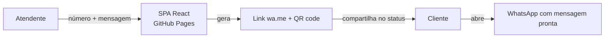

# WhatsApp Link Generator

Gerador de link e QR code que abrem o WhatsApp do cliente com o número certo e uma mensagem pronta,
para que quem vem pela divulgação de um atendente chegue identificado.

> 🚧 **Em desenvolvimento.** O repositório ainda não tem código: só a definição do projeto
> ([CLAUDE.md](CLAUDE.md)) e a primeira decisão de arquitetura ([ADR 0001](docs/adr/0001-mvp-estatico-e-hospedagem.md)).

[](LICENSE)
<!-- TODO(Pablo): badges de CI, React e TypeScript quando o workflow existir. -->

## Demonstração

<!-- TODO(Pablo): link do GitHub Pages e GIF em docs/assets/ (dados fictícios) quando o MVP for publicado. -->
Ainda não publicado.

## O problema

Numa loja em que toda a equipe usa o mesmo WhatsApp, o cliente que viu a promoção no status de um
atendente manda mensagem para o número geral, e nada garante que vai ser atendido por quem o trouxe. O
atendente pode perder a comissão.

## Funcionalidades

Em desenvolvimento (MVP):
- Informar o número de destino e a mensagem, com validação do formato brasileiro.
- Gerar o link `wa.me` com a mensagem preenchida.
- Gerar o QR code e baixar em PNG ou SVG.

Nada é salvo: tudo acontece no navegador.

## Tecnologias

- **React + TypeScript (strict) + Vite**: SPA estática, sem servidor, com tipagem rígida.
- **Biblioteca de QR code**: a única dependência de produção além do React; codificar QR na mão seria
  reinventar algo complexo.
- **Vitest + Testing Library**: testes do comportamento do usuário.
- **ESLint + Prettier**: lint e formatação.
- **GitHub Actions + GitHub Pages**: CI e hospedagem gratuitos, sem cold start.

## Arquitetura



O MVP não tem backend: o link `wa.me` é montado no navegador a partir do número e da mensagem. Um
backend (Django + Koyeb + Neon) só entra quando houver necessidade de contar cliques e editar links já
divulgados ([ADR 0001](docs/adr/0001-mvp-estatico-e-hospedagem.md)).

## Como rodar localmente

<!-- TODO(Pablo): conferir e testar os comandos depois do scaffold. -->
Em desenvolvimento. Pré-requisito: Node 24.

```bash
npm install
npm run dev
```

## Testes

<!-- TODO(Pablo): descrever a cobertura quando os testes existirem. -->
Em desenvolvimento: `npm test`.

## Decisões e aprendizados

- **Começar sem backend:** o problema principal se resolve no navegador; infraestrutura só entra com
  necessidade comprovada ([ADR 0001](docs/adr/0001-mvp-estatico-e-hospedagem.md)).
- **Hospedagem escolhida pelo caminho crítico:** quem escaneia o QR não pode esperar um servidor
  acordar, o que descartou planos gratuitos com cold start longo.
- **Fora do Netlify de propósito:** o plano gratuito divide créditos com o site do portfólio.

## Próximos passos

- **Contas:** links curtos editáveis (`/r/<slug>`) e contagem de cliques, com Django + DRF.
- **Equipe:** loja com vários atendentes, um link por atendente e painel do gerente.
- Recuperação de senha por e-mail, personalização do QR code e cliques por origem.

## Autor

**Pablo Costa**

- LinkedIn: https://www.linkedin.com/in/pablosilva013
- GitHub: https://github.com/pablosscosta
- Portfólio: https://portfolio-pablosscosta.netlify.app/
