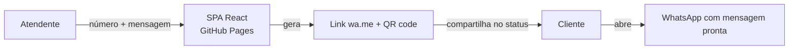

# WhatsApp Link Generator

Gerador de link e QR code que abrem o WhatsApp do cliente com o número certo e uma mensagem pronta,
para que quem vem pela divulgação de um atendente chegue identificado.

[](https://github.com/pablosscosta/whatsapp-link-generator/actions/workflows/ci.yml)
[](LICENSE)


## Demonstração

**https://pablosscosta.github.io/whatsapp-link-generator/**

<!-- TODO(Pablo): GIF em docs/assets/ com dados fictícios. -->

## O problema

Numa loja em que toda a equipe usa o mesmo WhatsApp, o cliente que viu a promoção no status de um
atendente manda mensagem para o número geral, e nada garante que vai ser atendido por quem o trouxe. O
atendente pode perder a comissão.

## Funcionalidades

- Número de destino em qualquer formato comum (`(11) 90000-0000`, `+55 11 90000-0000`), com validação
  de DDD e do tamanho de celular e fixo.
- Mensagem pronta opcional, de até 500 caracteres, com acentos, emojis e quebras de linha.
- Link `wa.me` com botões para copiar e abrir no WhatsApp.
- QR code exibido na tela e para baixar em PNG (1024 px) ou SVG.
- Ao editar o formulário, o resultado anterior some, para não divulgar um link desatualizado.

O link e o QR code **não expiram** e não dependem deste site: o QR code guarda o próprio link
`wa.me`, então continua funcionando mesmo se o site sair do ar. Em compensação, não dá para editá-los
depois de divulgados; para mudar o número ou a mensagem, é preciso gerar um novo.

Nada é salvo: tudo acontece no navegador.

## Tecnologias

- **React + TypeScript (strict) + Vite**: SPA estática, sem servidor, com tipagem rígida.
- **[`qrcode`](https://www.npmjs.com/package/qrcode)**: a única dependência de produção além do React.
  Gera SVG e PNG a partir do mesmo texto, que são exatamente os dois downloads; codificar QR na mão
  seria reinventar algo complexo.
- **Vitest + Testing Library**: testes do comportamento do usuário.
- **ESLint + Prettier**: lint e formatação.
- **GitHub Actions + GitHub Pages**: CI e hospedagem gratuitos, sem cold start.

## Arquitetura



O MVP não tem backend: o link `wa.me` é montado no navegador a partir do número e da mensagem. Um
backend (Django + Koyeb + Neon) só entra quando houver necessidade de contar cliques e editar links já
divulgados ([ADR 0001](docs/adr/0001-mvp-estatico-e-hospedagem.md)).

## Como rodar localmente

Pré-requisito: Node 24 (`.nvmrc`). Não há variáveis de ambiente.

```bash
npm install
npm run dev     # http://localhost:5173/whatsapp-link-generator/
```

Outros comandos: `npm run lint`, `npm run format`, `npm run build` e `npm run preview`.

## Testes

```bash
npm test            # modo watch
npm test -- --run   # uma vez, como no CI
```

- **Regras (`src/lib/`)**: normalização e validação do número (formatos, DDI, DDD, celular e fixo) e
  montagem do link (codificação de acentos, emojis, quebras de linha e caracteres reservados).
- **Interface (`src/App.test.tsx`)**: o fluxo do usuário com Testing Library — gerar link e QR code,
  erros de validação, copiar (sucesso e falha), baixar PNG e SVG e falha na geração do QR code.

O CI roda lint, verificação de formatação, testes e build em todo PR.

## Decisões e aprendizados

- **Começar sem backend:** o problema principal se resolve no navegador; infraestrutura só entra com
  necessidade comprovada ([ADR 0001](docs/adr/0001-mvp-estatico-e-hospedagem.md)).
- **Hospedagem escolhida pelo caminho crítico:** quem escaneia o QR não pode esperar um servidor
  acordar, o que descartou planos gratuitos com cold start longo.
- **Fora do Netlify de propósito:** o plano gratuito divide créditos com o site do portfólio.
- **Regras em funções puras:** validação do número e montagem do link ficam fora dos componentes, com
  testes unitários rápidos; os componentes só cuidam da interface.
- **Erros visíveis, nunca engolidos:** falhas ao copiar ou ao gerar o QR code aparecem para o usuário
  com uma alternativa (copiar manualmente, baixar o SVG).

## Próximos passos

- **Contas:** links curtos editáveis (`/r/<slug>`) e contagem de cliques, com Django + DRF.
- **Equipe:** loja com vários atendentes, um link por atendente e painel do gerente.
- Recuperação de senha por e-mail, personalização do QR code e cliques por origem.

## Autor

**Pablo Costa**

[](https://www.linkedin.com/in/pablosilva013)
[](https://github.com/pablosscosta)
[](https://portfolio-pablosscosta.netlify.app/)
